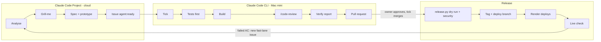

# ReviewRadar

Online reputation management for businesses with several locations: collect customer reviews, see how each location is rated, and reply faster.

**Status:** MVP done on demo data and online at <https://reviewradar-zo3u.onrender.com> (last release `v2026.11.12`). Data is not yet separated per business (see [Known issues](#known-issues-and-limits)).

ReviewRadar is also a **Claude Code training lab**: the app is built by a two-lane agent flow, from a request on the phone to a checked live release (see [How the app is built](#how-the-app-is-built)).

## Contents

- [Overview](#overview) · [Features](#features) · [Tech stack](#tech-stack)
- [Getting started](#getting-started) · [Configuration](#configuration) · [Sign in](#sign-in) · [Usage](#usage)
- [How the app is built](#how-the-app-is-built) · [Release and deploy](#release-and-deploy)
- [Project structure](#project-structure) · [Architecture](#architecture) · [Development](#development)
- [Known issues and limits](#known-issues-and-limits) · [Documentation](#documentation) · [Training lab](#training-lab)

## Overview

Clinics, spas, salons and similar businesses lose revenue to bad reviews and slow replies, and a manager of many locations cannot see at a glance which location needs attention. ReviewRadar gathers the reviews of every location in one place, scores each location, shows what customers talk about, and helps staff reply, with a reply draft from the Claude API.

## Features

| Area | What it does |
|---|---|
| Sign-in | Every page needs an account, except `/login/` and `/healthz/` |
| Dashboard | Key numbers, score per location, rating breakdown, latest reviews, reviews waiting for a reply, reply speed |
| Location page | Score, rating breakdown, newest reviews, weekly score trend, score goal, "What customers talk about" |
| Reviews page | All reviews, newest first, 20 per page; search by words; filters by location, rating, week and topic |
| CSV import and export | Import reviews from a CSV file (duplicates skipped, bad rows listed); export the filtered reviews |
| Replies | Reply to a review; reply templates; "Suggest a reply" with the Claude API in the language of the review; follow-up of bad reviews; overdue bad reviews flagged |
| Topics | Seven topics found by keywords, with counts, share and average rating, on their own page and on other pages |
| Compare | Two locations side by side, with CSV export |
| Monthly report | One month for every location next to the month before, with CSV export |
| Settings | Score goals per location, locations, reply templates |
| JSON API | `/api/dashboard/`: review count and average rating per location |

The specification of each feature is in [`specs/<feature>/`](specs/README.md); the screens are in the clickable prototype `design/app/prototype.html`.

## Tech stack

- Python 3.11+, Django 5, SQLite; `gunicorn` and `whitenoise` on Render
- `uv` for the environment and the locked dependencies
- `pytest` (`pytest-django`, `pytest-mock`, `pytest-cov`), `ruff`, `mypy --strict` with `django-stubs`
- Claude API for reply suggestions, called with the standard library (`reviews/claude_client.py`); Sentry for server errors when `SENTRY_DSN` is set
- GitHub Actions: `../.github/workflows/checks.yml` runs lint, types, tests, the coverage gate, a browser regression of the main screens and an accessibility scan

## Getting started

### Prerequisites

- Python 3.11 or newer
- [`uv`](https://docs.astral.sh/uv/)

### Install and run

```bash
uv sync
uv run python manage.py migrate
uv run python manage.py seed_demo_data
uv run python manage.py runserver
```

Open http://127.0.0.1:8000/. If port 8000 is busy, use `runserver 8800`.

`seed_demo_data` **deletes the local data** and creates 1 business, 3 locations (Airport, Downtown, Riverside) and their demo reviews. Options:

| Option | Effect |
|---|---|
| `--branches N` | Add N extra locations with 3 reviews each (for example `--branches 597` gives about 1,800 reviews) |
| `--with-new-branch` | Add a location without reviews (the dashboard shows it without a score) |

## Configuration

| Variable | Default | Meaning |
|---|---|---|
| `DJANGO_SECRET_KEY` | insecure development key | Secret key. Always set it outside development. |
| `DJANGO_DEBUG` | `1` | Set to `0` in production. |
| `DJANGO_ALLOWED_HOSTS` | local hosts | Extra host names; on Render `RENDER_EXTERNAL_HOSTNAME` is added. |
| `REVIEWRADAR_DEMO_PASSWORD` | not set | Password of the `demo` account made by `seed_demo_data`. |
| `ANTHROPIC_API_KEY` | not set | Turns on "Suggest a reply". Never printed or logged. |
| `ANTHROPIC_MODEL` | `claude-haiku-5-5` | Model of the reply suggestion. |
| `REVIEWRADAR_AI_FAKE` | not set | `1` gives a fixed demo draft with no network. With `DEBUG` on and no key, the fixed draft is used too. |
| `SENTRY_DSN` | not set | Sends server errors to Sentry, without personal data. |

Time zone is `Asia/Ho_Chi_Minh`. Never commit `.env` or secrets.

## Sign in

Every page needs an account. Only the sign-in page (`/login/`) and the health path (`/healthz/`) are open without one.

- **Add an account:** `uv run python manage.py create_user <username>`. It asks for the password twice, checks it with Django's password rules, and prints `Created user <username>.`
- **Reset a password:** `uv run python manage.py changepassword <username>`.
- **Demo account, locally:** `REVIEWRADAR_DEMO_PASSWORD='<a strong password>' uv run python manage.py seed_demo_data` creates the user `demo`. Without the variable no demo account is made.
- **Demo account, on Render:** set `REVIEWRADAR_DEMO_PASSWORD` in the Render dashboard (Environment). `render.yaml` lists it with `sync: false`, so its value is never in the repository.

## Usage

| Address | What it shows |
|---|---|
| `/login/`, `/logout/` | Sign in and sign out |
| `/` | Redirects to the dashboard |
| `/dashboard/` | Key numbers, score per location, rating breakdown, latest reviews |
| `/locations/<id>/` | One location: score, goal, trend, topics, newest reviews |
| `/reviews/` | All reviews with search and filters (`?page=N&search=words&location=ID&rating=good`, `bad` or `1` to `5`, `&week=YYYY-MM-DD`, `&topic=<slug>`) |
| `/reviews/import/`, `/reviews/export/` | Import a CSV file; export the filtered reviews as CSV |
| `/reviews/<id>/reply/`, `/reviews/<id>/follow-up/` | Reply to a review (with "Suggest a reply"); follow up a bad review |
| `/replies/` | Reviews that wait for a reply |
| `/topics/` | What customers talk about |
| `/compare/` | Two locations side by side (`/compare/export/` for CSV) |
| `/reports/` | Monthly report (`/reports/export/` for CSV) |
| `/settings/` | Score goals, locations and reply templates |
| `/api/dashboard/` | JSON: review count and average rating per location |
| `/healthz/` | `ok` and the `X-Commit` header, for the host's health check (no sign-in) |

## How the app is built

Work goes through **two lanes in one flow**. The **Claude Code Project** (claude.ai/code or the phone app) turns a request into ready GitHub issues. The **Claude Code CLI loop** on the Mac mini builds each issue and opens its pull request. The owner decides at a few fixed points, each a tap on a choice card.



**Lane 1, the Project** (ADR-010, ADR-011, ADR-012):

1. **Analyse:** read the code and the rules, rate the work Easy, Medium or Hard and its risk, choose the lane.
2. **Grill-me:** every open decision becomes a choice card, so the build never has to ask.
3. **Spec:** full lane: a spec pull request in `specs/<feature>/` with numbered ACs and a test matrix (ADR-026); a new screen first goes into the clickable prototype `design/app/prototype.html` (ADR-030). Fast lane (Easy): a short spec inside the issue.
4. **Gate 1:** the owner taps "Prototype ổn", "Merge PR spec" or "OK".
5. **Issues:** one per task, each listing every file it may change (ADR-023). An issue is labelled `agent:ready` only when `ops/pinned_tests.py --unlisted` exits 0 and a fresh agent reading only the issue has zero questions. Posted from the Mac mini with the owner's login; a card tap is the approval (ADR-033).

The Project writes no application code; the only pull request it opens is the spec pull request.

**Lane 2, the CLI loop** (ADR-008, ADR-009, ADR-014, `ops/README.md`):

- `ops/start-loop.sh` runs a tick every 5 minutes; each tick starts up to 3 builds, one `claude -p` per issue in its own worktree.
- It skips issues assigned to a team member (ADR-028). A `risk:high` issue stops after the plan with `agent:plan-review` until the owner approves the plan (ADR-027).
- Tests first, written by a separate agent; the build may edit only the files its issue lists, and may fix one technical stop itself (ADR-024).
- Every build runs `/code-review` on its diff, at most two rounds of fixes (ADR-029), then the verify report (ruff, mypy, pytest, each AC, screenshots on a demo database) shared as a private artifact.
- The pull request carries the evidence. A plain comment is a change request; the owner's approval comment lets the tick merge on green CI (ADR-016). Claude builds never merge.
- Tasks of an epic merge into `epic/<n>-<slug>`; the owner reviews the epic pull request once, with a checklist (ADR-021, ADR-022).

**The owner's taps:** request · grill-me · Gate 1 (with the prototype for screens) · approve the pull request · "phát hành" (release) · OK on the release dry run.

**Pages that show the flow** (private links, open to the owner's account):

- Animated flow, Vietnamese: <https://claude.ai/artifact/FuNb8ABodLS4HUDscAbGAp>
- Animated flow, English: <https://claude.ai/artifact/JmmfvqmNgyGM3it1VARPUZ>
- Slides "Two Lanes, One Flow": <https://claude.ai/artifact/7SLBM1jd6GhVAFKXUT6yvv>
- Living release notes: <https://claude.ai/artifact/9YeTDzCKwuvkYq2jDphaye>

## Release and deploy

The live site is <https://reviewradar-zo3u.onrender.com>, on Render's free plan (`render.yaml` at the repository root). A merge to `main` does not change it; a release does, once per sprint or epic, only when the owner says so (ADR-017).

1. `uv run python ops/release.py --dry-run` on the Mac mini lists the commit, the branch, the tag and the pull requests to ship, and runs three security checks (deploy settings, `pip-audit`, secrets) plus a Claude security review (ADR-031). The owner answers OK.
2. `uv run python ops/release.py --notes-url <url>` pushes the branch `release/sprint-N`, the tag `vYYYY.MM.DD` and moves `deploy`, creates the GitHub Release page, and prints a `Project settings:` line when `.claude/project-instructions.md` changed. The living release notes page is updated.
3. Render deploys `deploy` after the GitHub `Checks` pass. If a deploy fails, the previous version stays online.
4. `uv run python ops/live_check.py` waits for the new commit on `/healthz/`, opens the main screens and checks the security headers. `ops/uptime.py` probes the site after every tick. For an epic, each AC is checked on the live site; a failed AC becomes a new fast-lane issue.
5. A bad release: `uv run python ops/rollback.py --dry-run`, then the real run on the owner's OK, returns to the previous release through Render's API (ADR-032).

Notes on the free plan: the site sleeps after 15 minutes without visits (the first visit then waits about a minute), and every start fills the database with the demo data again.

## Project structure

```
reviewradar/            Django project (settings, urls, monitoring)
reviews/                Django app
  models.py             Data definitions only
  repositories.py       Data access (queries)
  services.py, *_service.py  Business rules
  forms.py              Input validation
  views.py, *_views.py  Thin HTTP layer
  claude_client.py      The only code that calls the Claude API
  templates/, static/   Pages, stylesheet and tab icon
  management/commands/  seed_demo_data, create_user
  tests/unit/, tests/integration/
ops/                    The loop, release, live check, rollback and uptime (ops/README.md)
specs/                  One folder per feature: intent, spec, tasks (specs/README.md)
design/                 The clickable prototype of the whole app (design/README.md)
docs/app/               Issues, templates, project context
docs/learning/          The Claude Code training: courses, journal, exercises, epics
.claude/                Rules, knowledge (ADRs, business rules, pitfalls), app skills, project instructions
../plugins/agent-flow/  The flow skills, sub-agents, commands and hooks (ADR-020)
```

## Architecture

Clean architecture with the logic in the service layer (`.claude/rules/architecture.md`):

- **Views** only read the request, call a service and render. No business logic.
- **Services** hold the business rules and return frozen dataclasses.
- **Repositories** own the database queries.
- **Models** define data only.

Rules: type hints everywhere and strict `mypy`; validate input with Django Forms; no `*` imports; no Django signals for business logic; no N+1 queries (tests assert the query count of list pages); never log personal data or credentials; every template field with customer text carries `data-sensitive`.

## Development

### Quality checks

```bash
uv run ruff check .    # lint
uv run mypy .          # types (strict)
uv run pytest          # tests with coverage
uv run coverage report --include="reviews/services.py,reviews/repositories.py" --fail-under=90   # coverage gate
uv run pytest ../plugins/agent-flow/hooks/tests .claude/skills ops/tests --no-cov   # hooks, skill scripts, ops
uv run python .claude/skills/check-in-browser/browser_check.py   # browser check (once: uv run playwright install chromium)
```

Target: 90% coverage on services and repositories. Mock external APIs; tests never use the network.

### Working rules

- Work is tracked as GitHub issues. Branch `<kind>/<number>-<description>` (`bug`, `feat`, `task`, `epic`), never `main`.
- Commit: title, blank line, detail, blank line, `Part of #<number>`.
- Pull request into `main`: title `[type] title`; What, Why, How tested, Evidence, One concern; ends with `Closes #<number>`. A human approves; the tick or the owner merges.
- The rules are in [`.claude/CLAUDE.md`](.claude/CLAUDE.md) and [`.claude/rules/`](.claude/rules); the decisions are the ADRs in [`.claude/knowledge/decisions/`](.claude/knowledge/decisions/README.md).

### Decisions about the flow

| ADR | Decision |
|---|---|
| 008, 009 | The loop builds from GitHub issues and opens pull requests; the owner merges |
| 010, 011, 012 | The Project takes requests and writes issues; spec pull request and fast lane |
| 014, 015, 018 | Parallel builds in one tick, guards and stacked pull requests |
| 016 | The tick merges on the owner's approval comment |
| 017 | Deploys go out only by release |
| 020 | The flow is the `agent-flow` plugin |
| 021, 022 | Epic branch, epic reviewed once |
| 023, 024 | No manual label; the loop's self-fix |
| 026 | Issue pack and test matrix |
| 027, 028 | Plan and tests decisions, `risk:high` plan review; member assignment |
| 029 | `/code-review` on every build, browser regression in CI, living release notes |
| 030 | One clickable prototype of the app |
| 031 | Security checks and review before every release |
| 032 | Live check, rollback, uptime, Sentry, accessibility scan |
| 033 | A card tap approves the Mac mini's GitHub writes |

## Known issues and limits

- Data is not limited per business: every signed-in account sees the reviews of every business. Do not use real customer data until access per business is added.
- On Render the database is filled with demo data at every start; nothing typed online is kept.
- The security checks, the GitHub Release page, the settings reminder and the live check have not yet run in a real release; the next release is the first.

## Documentation

- [`docs/app/issues/README.md`](docs/app/issues/README.md): index of the first issues
- [`docs/app/reviewradar-project-context-2026-10.md`](docs/app/reviewradar-project-context-2026-10.md): project context and MVP scope
- [`specs/README.md`](specs/README.md): specs per feature
- [`ops/README.md`](ops/README.md): the loop, release, live check and rollback
- [`.claude/knowledge/`](.claude/knowledge/): ADRs, business rules, known pitfalls

## Training lab

Each day of the lab adds a Claude Code practice to this real project instead of a toy exercise.

| Day | Topic | Result |
|:---:|---|---|
| 1 | Setup and Claude 101 | Project skeleton, `CLAUDE.md`, CI ([journal](docs/learning/journal/day-01.md)) |
| 2 | Issue analysis, reproduce and understand | Five issues analysed, failing tests, first skills and sub-agents ([journal](docs/learning/journal/day-02.md)) |
| 3–10 | Checkpoints 1 and 2; issues, skills, hooks and the loop | No journal; the record is the issues, pull requests and ADR-008 to ADR-025 |
| 11 | Checkpoint 3, developer track | Hook, Notion MCP, `/code-review` found #460 (fixed by PR #461), browser checks |
| 12 | From request to issues | Issue pack and test matrix (ADR-026) |
| 13 | Build gaps | Plan and test decisions (ADR-027), member assignment (ADR-028) |
| 14 | Test and harden | `/code-review` on every build, browser regression in CI (ADR-029) |
| 15 | Release and retro | Release `v2026.11.12`, retro issues #485 to #490, prototype step, security check, post-release checks, card approval (ADR-030 to ADR-033) |
